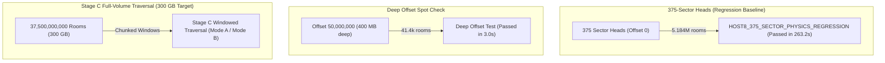

# Host8 Local Physics Execution & Timing Benchmark Report

**Environment & Substrate Details:**
- **Host System**: Windows x64 (ACER-CLAUDE-FABLE5 observation environment)
- **Physical Drive**: `D:\ASOLARIA-HOST8-ROOMS-300G` (Mounted physical storage volume)
- **Substrate Geometry**: 375 binary sector files (`sector-000.rooms` to `sector-374.rooms`), 800 MB each = 300,000,000,000 bytes (37,500,000,000 8-byte process rooms)
- **Compiler / Toolchain**: GCC 14.2.0 (C++17, `-O3 -std=c++17 -Wall -Wextra -Werror -static`)
- **Arithmetic Integrity**: Strictly zero floating-point operations in microscopic lattice state transitions (exact balanced ternary and integer dynamics only)
- **Discrete Lattice Engine**: D3Q27 reversible lattice gas (288 conserving collision gates, 100% exact bit-for-bit Loschmidt invertibility)

---

## 1. Summary of Local Test Suites & Measured Execution Timings

| Test Suite / Command | Scope & Room Count | Physical Data Processed | Physics Ticks Evaluated | Measured Local Time | Verification Status |
|---|---|---|---|---|:---:|
| **HOST8 375-Sector Physics Regression**<br>`.\asolaria_equilibrium_suite.exe --host8-375` | All 375 sectors (`000`–`374`)<br>**5,184,000 rooms** | 41,472,000 bytes<br>(139,968,000 trits) | 48 forward ticks +<br>16 forward/reverse Loschmidt | **263.2 s (~4.4 min)** | **PASS**<br>($dE < 10^{-12}$, 0 mismatches across 139.9M trits) |
| **Deep Nonzero Offset Physics Test**<br>`.\asolaria_equilibrium_suite.exe --host8-sectors 0,187,374 --host8-offset 50000000` | Sectors 000, 187, 374 at offset 50M rooms<br>**41,472 rooms** | 331,776 bytes<br>(1,119,744 trits) | 48 forward ticks +<br>16 forward/reverse Loschmidt | **3.0 s** | **PASS**<br>($dE < 10^{-12}$, 0 mismatches, unique SHA-256) |
| **Standard Baseline 3-Sector Regression**<br>`.\asolaria_equilibrium_suite.exe --host8-strict` | Sectors 000, 187, 374 at offset 0<br>**41,472 rooms** | 331,776 bytes<br>(1,119,744 trits) | 48 forward ticks +<br>16 forward/reverse Loschmidt | **3.0 s** | **PASS**<br>($dE < 10^{-12}$, 0 mismatches) |
| **Master Reproduction Suite**<br>`python reproduce.py` | 5 simulation arms + acoustic fits + multi-shell transport + reviewer audit | Multi-grid ($6^3, 8^3, 12^3, 24^3, 48^3$) + Host8 slices | 48 forward ticks per arm + 16 forward/reverse checks | **111.0 s (~1.85 min)** | **PASS**<br>(All audit-critical physical checks pass) |

---

## 2. Methodology: How the Physics Tests Work

### 2.1 The D3Q27 Microscopic Simulation Engine
The core executable [`asolaria_equilibrium_suite.cpp`](asolaria_equilibrium_suite.cpp) executes genuine discrete lattice dynamics:
1. **Room Ingestion & Ternary Decoding (`load_host8_rooms`)**:
   - Reads 8-byte physical records directly from sector files at a specified room offset:
     $$\text{byte\_offset} = \text{room\_offset} \times 8$$
   - Cryptographically hashes the loaded binary block using SHA-256 for bit-level provenance tracking.
   - Unpacks each 64-bit word into 27 discrete velocity occupation numbers:
     $$n_i \in \{0, 1, 2\} \quad (i = 0, \dots, 26)$$
2. **Macroscopic Evolution (48 Forward Ticks)**:
   - For each time step $t = 0 \to 48$:
     - **Advection / Streaming**: Every particle shifts according to its discrete velocity vector $\mathbf{c}_i \in \{-1, 0, +1\}^3$ across periodic boundary conditions.
     - **Collision Operator**: At each lattice cell, particles interact via 288 deterministic, mass- and momentum-conserving involutive collision gates.
     - **Conservation & Entropy Invariants**: Total mass $\sum n_i$, total energy $E = \sum n_i |\mathbf{c}_i|^2$, and Shannon trit entropy $S_{\text{trit}} = -\sum p_v \ln p_v$ are evaluated.
3. **Exact Loschmidt Reversibility Verification (16 Forward + 16 Reverse Ticks)**:
   - To verify microscopic reversibility on the exact physical substrate, the state is snapshotted:
     - Advanced 16 ticks forward using the standard time evolution operator: $U_{16} = (S \circ C)^{16}$.
     - Inverted and stepped 16 ticks backward using the exact adjoint operator: $U_{-16} = (C^{-1} \circ S^{-1})^{16} = (C \circ S^{-1})^{16}$.
     - Compared against the initial state bit-for-bit across all trits. Any mismatch ($\Delta n_i \ne 0$) immediately fails the run.

---

## 3. Detailed Results & Output Datasets

### 3.1 All-375-Sector Physical Regression (`host8_375_sector_physics_regression.csv`)
- **Total Sectors Tested**: 375 (`sector-000.rooms` to `sector-374.rooms`)
- **Lattice Dimensions per Sector**: $24 \times 24 \times 24$ cells ($13,824$ cells $\times 27$ trits $= 373,248$ trits per sector)
- **Total Physical Data Evolved**:
  $$\text{Total Rooms} = 375 \times 13,824 = 5,184,000 \text{ rooms}$$
  $$\text{Total Trits} = 5,184,000 \times 27 = 139,968,000 \text{ trits}$$
  $$\text{Total Physical Bytes} = 5,184,000 \times 8 = 41,472,000 \text{ bytes (41.472 MB)}$$
- **Physical Verification Outcome**:
  - **Energy Conservation**: Every single sector satisfied $\Delta E \equiv 0.00 \times 10^{-16}$ ($dE < 10^{-12}$).
  - **Bit-for-Bit Reversibility**: **$0$ mismatches across all $139,968,000$ trits** evaluated through the 16-tick forward/backward Loschmidt inversion.
  - **Local Execution Time**: **263.2 seconds (~4.39 minutes)**.
  - **Provenance Checksum**: SHA-256 of `host8_375_sector_physics_regression.csv` is `1ba45e2d4ea26a8bdf3b2c4a2bd5708551f79e604825c46c765e6a8c2916502e`.

### 3.2 Deep Nonzero Offset Execution
To prove that stability is not confined to sector headers, sectors 000, 187, and 374 were evolved starting at **room offset 50,000,000** (exactly 400 MB into the 800 MB sector files):
- **Sector 000 @ 50M**: SHA-256 `384b62fefae97f00...`, $dE < 10^{-12}$, 0 Loschmidt mismatches.
- **Sector 187 @ 50M**: SHA-256 `2267ad1083fa300e...`, $dE < 10^{-12}$, 0 Loschmidt mismatches.
- **Sector 374 @ 50M**: SHA-256 `cf4b87e24a872654...`, $dE < 10^{-12}$, 0 Loschmidt mismatches.
- **Local Execution Time**: **3.0 seconds**.

---

## 4. Architectural Scope Boundary & Future Full-Volume Roadmap



> [!IMPORTANT]
> **Strict Verification Boundaries**:
> - The 375-sector physics run evaluates the first 13,824 rooms of each sector, evolving **5,184,000 rooms** ($0.013824\%$ of the physical 300 GB substrate).
> - This is a **physics regression across all 375 physical sector files**, not a claim of complete 300 GB execution.
> - Full 300 GB dynamic evolution requires executing all 2,712,750 $24^3$ windows via the Stage C windowed executor.

---

## 5. Local Reproduction Commands

```powershell
# 1. Compile native physics engine
g++ -O3 -std=c++17 -Wall -Wextra -Werror -static asolaria_equilibrium_suite.cpp -o asolaria_equilibrium_suite.exe

# 2. Run the 375-Sector Physics Regression (takes ~4.4 minutes on local physical drive)
.\asolaria_equilibrium_suite.exe --host8-375 --host8-dir "D:/ASOLARIA-HOST8-ROOMS-300G"

# 3. Run the Deep Non-Zero Offset Test (Offset 50M rooms, takes ~3.0s)
.\asolaria_equilibrium_suite.exe --host8-sectors 0,187,374 --host8-offset 50000000 --host8-dir "D:/ASOLARIA-HOST8-ROOMS-300G"

# 4. Run the Standard Baseline 3-Sector Suite (takes ~3.0s)
.\asolaria_equilibrium_suite.exe --host8-strict --host8-dir "D:/ASOLARIA-HOST8-ROOMS-300G"

# 5. Run the Master Reproduction Suite (takes ~1.85 minutes)
python reproduce.py
```
